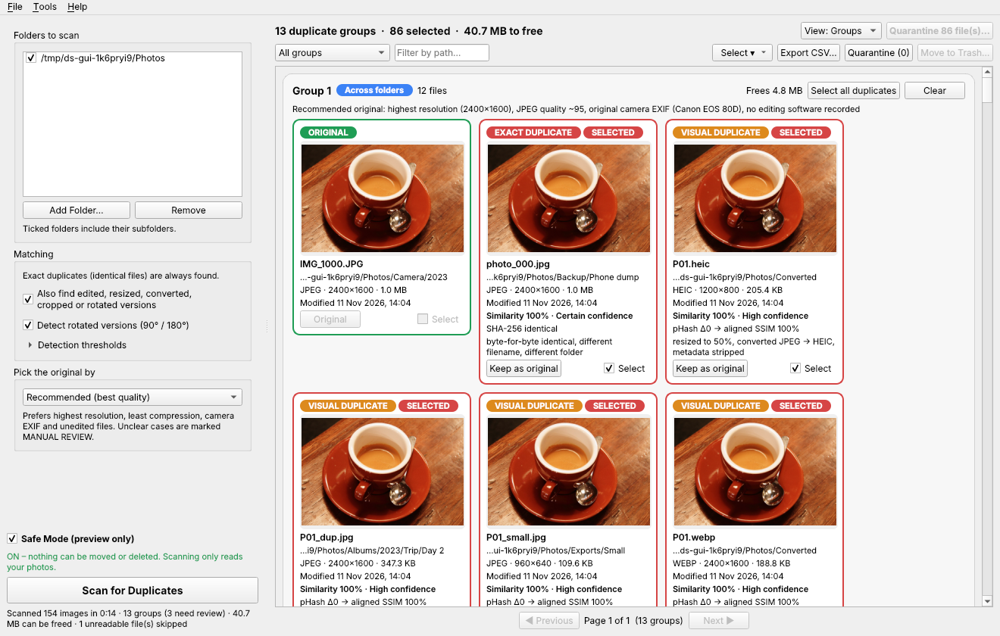
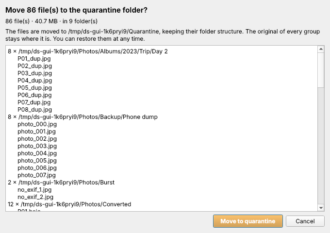
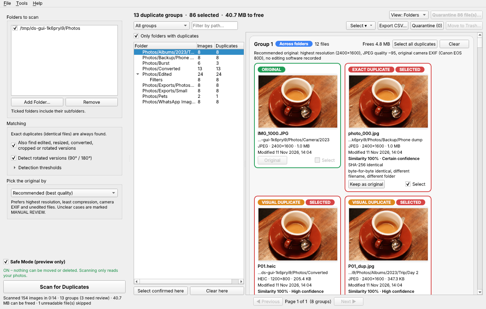

<p align="center"></p>
<h1 align="center">DupeSweep</h1>
<p align="center"><b>Find exact duplicates and edited versions of your photos, and clean them up safely.</b><br>
Free and open source for Windows, macOS and Linux.</p>

<p align="center">
<a href="https://github.com/devid9602/DupeSweep/actions/workflows/ci.yml"></a>
<a href="https://github.com/devid9602/DupeSweep/actions/workflows/codeql.yml"></a>
<a href="https://scorecard.dev/viewer/?uri=github.com/devid9602/DupeSweep"></a>
<a href="https://github.com/devid9602/DupeSweep/releases/latest"></a>
<a href="LICENSE"></a>
</p>



DupeSweep scans your photo folders and groups every copy of the same photograph, even when a copy has been
resized, re-compressed, converted to another format, colour-edited, cropped or rotated. It recommends the
best-quality original to keep and never deletes anything by itself.

## Download

Get the latest version from the **[Releases page](https://github.com/devid9602/DupeSweep/releases/latest)**.

| System | Requires | File | How to start |
|---|---|---|---|
| Windows | Windows 10 (1809 or later) or 11, 64-bit | `DupeSweep-Windows-x64.zip` | Unzip, open the `DupeSweep` folder, run `DupeSweep.exe`. If SmartScreen appears: **More info → Run anyway**. |
| Mac with Intel processor | macOS 12 Monterey or later | `DupeSweep-macOS-Intel.zip` | Unzip, drag `DupeSweep.app` to Applications, then **right-click → Open** the first time. |
| Mac with Apple Silicon (M1–M4) | macOS 12 Monterey or later | `DupeSweep-macOS-AppleSilicon.zip` | Same as above. |
| Linux | 64-bit, glibc 2.35 or later (Ubuntu 22.04+, Debian 12+, Fedora 36+) | `DupeSweep-Linux-x64.tar.gz` | Extract and run `DupeSweep/DupeSweep`. |

The downloads are not code-signed yet, so Windows and macOS show a one-time warning.
If macOS says the app is damaged, run `xattr -cr /Applications/DupeSweep.app` once in Terminal.

**Check your download (optional).** Every release includes `SHA256SUMS.txt` and a signed record of how each file was
built. With the [GitHub CLI](https://cli.github.com/) installed, this confirms that a file was built by this
repository's release pipeline and hasn't been changed:

```
gh attestation verify DupeSweep-macOS-Intel.zip --repo devid9602/DupeSweep
```

## What it finds

| Label | Meaning |
|---|---|
| **ORIGINAL** | The recommended file to keep |
| **EXACT DUPLICATE** | A byte-for-byte identical file, whatever its name or folder |
| **VISUAL DUPLICATE** | The same photo resized, re-compressed or converted (JPG, PNG, HEIC, WEBP, TIFF…) |
| **EDITED VERSION** | The same photo with brightness, contrast, colour, filter, crop or rotation changes; notes say what changed |
| **POSSIBLE MATCH** | Might be the same photo; needs your eyes and is never pre-selected |
| **MANUAL REVIEW** | (on a group) the original can't be chosen confidently, so nothing is pre-selected |

The original is chosen by resolution, compression quality, camera EXIF data and signs of editing, never by date or
file size alone.

## Safety

- **Scanning only reads your photos.** It never changes, renames or moves them.
- **Safe Mode is on by default.** While it is on, nothing can be moved or deleted.
- **Nothing is removed automatically.** Every action first lists the files and folders involved and asks you to confirm.
- **Quarantine is a move, not a delete.** Files keep their folder structure and **Restore** puts them back exactly where they were, without overwriting anything.
- **The original of a group can never be selected for removal.**
- **Look-alikes are not confirmed.** Burst shots, re-takes and different photos with similar backgrounds are kept apart or shown only as a possible match.
- **Permanent deletion** is only possible from the Quarantine window, after a second confirmation.



## How to use it

1. Click **Add Folder…** (or drag folders into the window). Tick a folder to include its subfolders.
2. Click **Scan for Duplicates**. You can pause, resume or cancel at any time.
3. Review the groups. Use **View: Folders** to work folder by folder, and the filter to see only groups that need review.
4. Click **Keep as original** on a different copy if you disagree with the recommendation.
5. Export a CSV report if you want a record.
6. When you are ready, turn **Safe Mode** off and click **Quarantine**. Restore anything from **Quarantine** later.



## How detection works

1. **Discovery** of image files (JPG, PNG, HEIC/HEIF, AVIF, WEBP, TIFF, GIF, BMP and camera RAW previews).
2. **Exact duplicates** by SHA-256, computed only for files of equal size.
3. **Fingerprints** from one small decode per image: average, difference, wavelet and perceptual hashes (in four rotations), plus a 64-pixel structure thumbnail.
4. **Candidates and validation.** A hash index and low-resolution probes pick likely pairs (about 0.03% of all pairs). Each one is aligned with a crop, rotation and tilt search, then checked with SSIM, regional structure, a full-detail re-check and EXIF capture times.
5. **Groups.** Only high-confidence links form groups, and every member is verified directly against the original, so weak links cannot chain unrelated photos together.

Fingerprints and pair verdicts are cached, so unchanged photos are never analysed twice.
No internet connection is used and no AI model is needed; your photos never leave your computer.

## Tested

The automated tests build a photo library covering every scenario and run on Windows, macOS and Linux for each change:

- 12 scenario types (exact copy, resize, tone, colour filter, heavy compression, PNG→JPG, WEBP, HEIC, crop, 90° rotation, tilt + editor export, nested folders): all detected.
- Recommended original correct in 9 of 9 groups.
- 10 look-alike pairs (stereo pair, bursts, re-take, halves of one scene, textures): none confirmed as duplicates.
- 8,000-image library: 0 false positives; first scan about 3.6 minutes on a 2-core machine, a rescan 13 seconds.
- File safety: quarantine and restore are byte-identical, originals are never touched, nothing is overwritten, and Safe Mode blocks every move and delete.

## Run from source

```bash
git clone https://github.com/devid9602/DupeSweep.git
cd DupeSweep
python -m pip install --require-hashes -r requirements.lock     # Python 3.12, exact tested versions
python run_dupesweep.py
```

Run the tests with `python -m pip install --require-hashes -r requirements-dev.lock` and then `python -m pytest`.

## Contributing and security

Contributions are welcome through pull requests. `main` and `develop` are protected, and every change needs passing
checks and the maintainer's approval. See [CONTRIBUTING.md](CONTRIBUTING.md) and the
[code of conduct](CODE_OF_CONDUCT.md).
Please report security problems privately as described in [SECURITY.md](SECURITY.md).
Changes between versions are listed in [CHANGELOG.md](CHANGELOG.md).

## Licence

MIT. See [LICENSE](LICENSE). The software comes without warranty; keep a backup of photos you care about.
